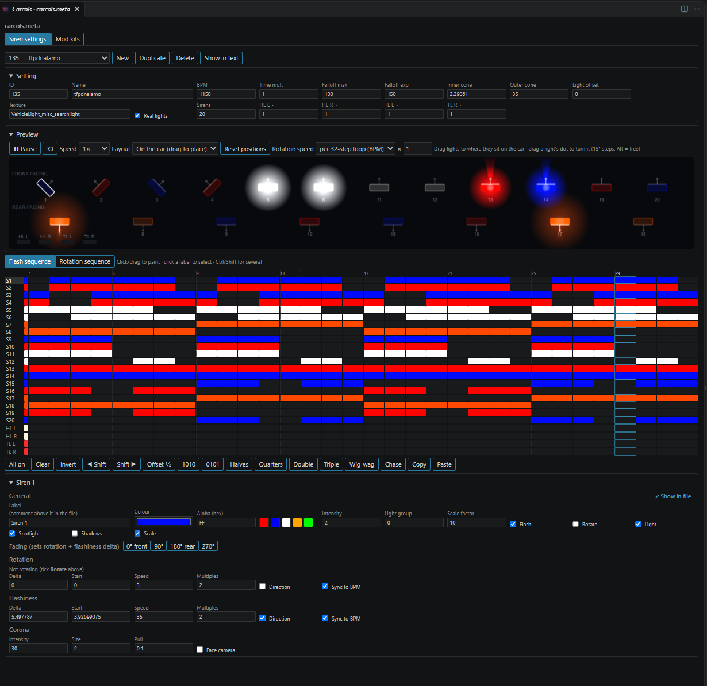
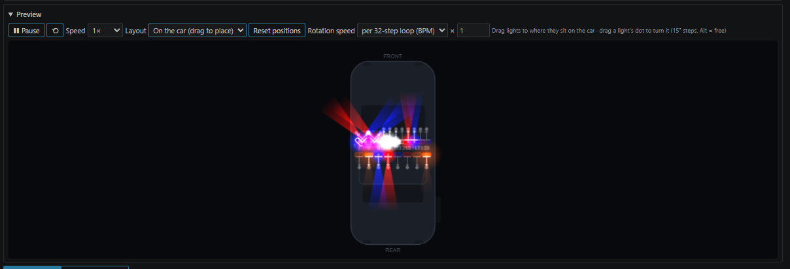
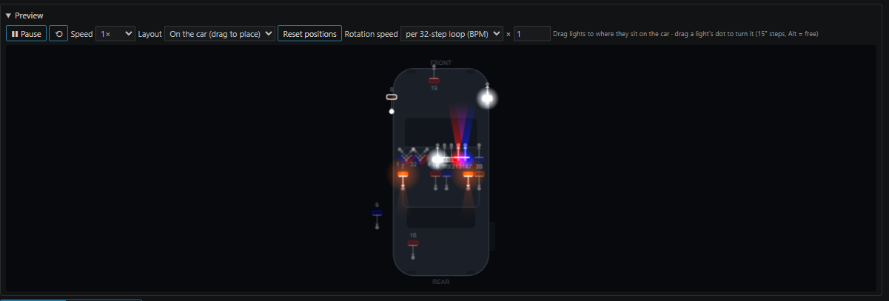
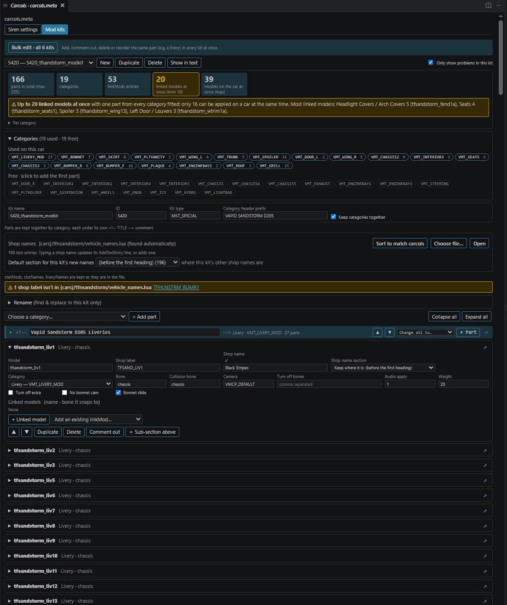
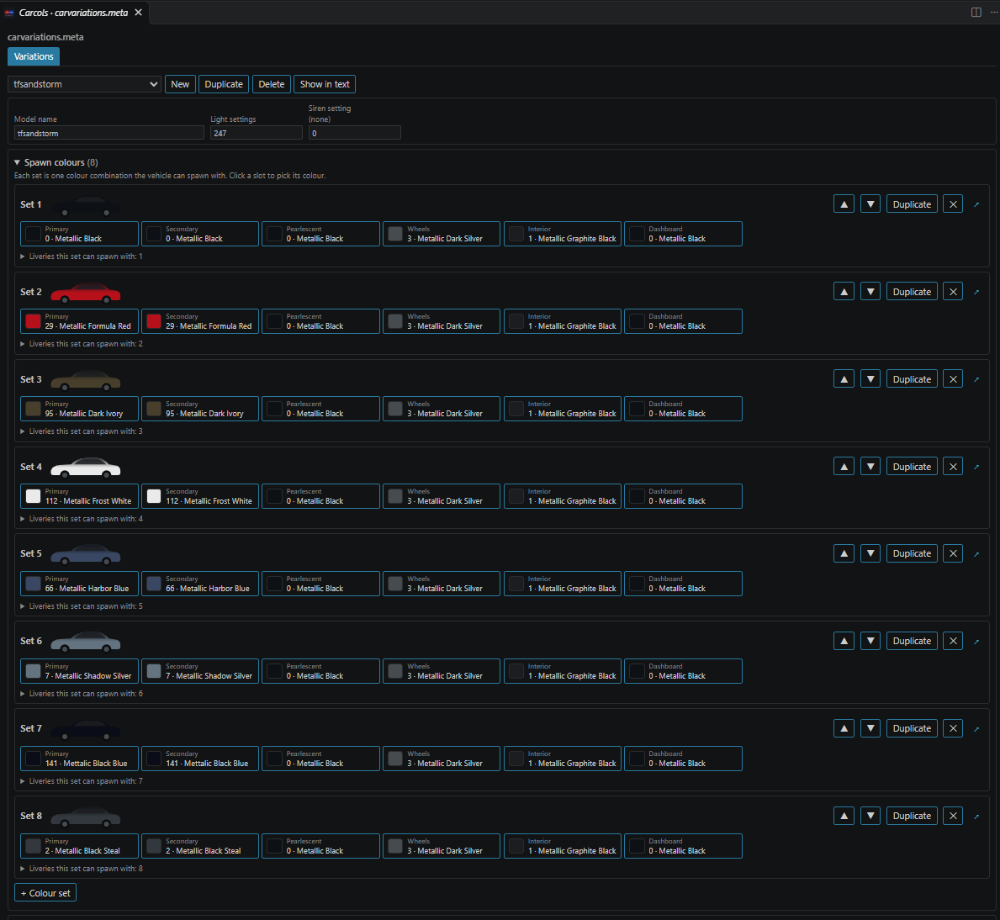
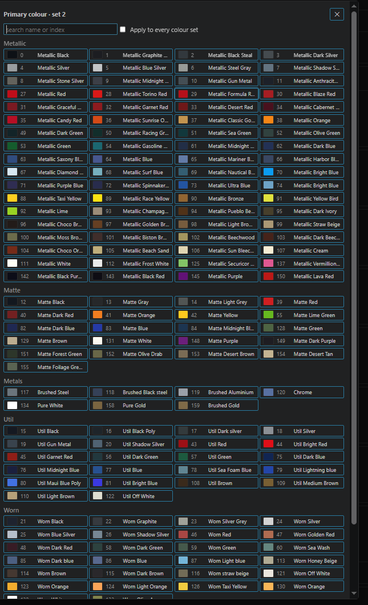
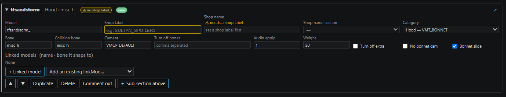

# GTA Meta Editor

A VS Code extension for editing GTA V / FiveM vehicle metas without hand-writing XML. Sirens, mod kits, spawn colours and vehicles.meta fields each get a visual editor beside the text. The `.meta` file stays the source of truth: every change is written straight into the text, keeps your indentation and comments, and can be undone with Ctrl+Z.

It opens a panel for:

| File | What you can edit |
|---|---|
| `carcols.meta` | **Siren settings**: a 32-step sequencer grid, every siren field and a live preview. **Mod kits**: parts, categories, linked models, slot names and shop names |
| `carvariations.meta` | **Variations**: spawn colour sets with game colour names, kits, siren setting, light settings and plate probabilities |
| `vehicles.meta` | **Vehicles**: every field of each vehicle, grouped and typed, plus txdRelationships |
| `vehicle_names.lua` | **Shop names**: the `AddTextEntry` lines for the parts' shop labels, slot names and game names, edited from the panel |

Any `.meta` file is also checked for formatting mistakes, such as the stray "s" a missed Ctrl+S leaves behind.

---

## Features

- **Edit beside the text.** The panel and the text stay in sync both ways. Only the `<Item>` you change is rewritten, so the rest of the file is never touched.
- **Siren sequencer.** A 32-step grid you can click and drag to paint, with pattern tools (wig-wag, chase, halves, offsets, copy/paste) and head/tail light sequences.
- **Live preview.** An animated top-down view at the setting's BPM. You can drag lights to where they sit on the car and turn them to set their direction.
- **Mod kits by category.** Parts are grouped under `<!-- CATEGORY -->` headers. You can fold, reorder, rename, comment out, or move a whole category to another one.
- **Shop names built in.** Link the resource's `vehicle_names.lua` and type a part's shop name right next to it. Every line is filed in the right vehicle section.
- **Bulk edit across kits.** Liveries (or any category) are listed once for every kit in the file. You can see which kits are missing one, comment out, delete, reorder, or add to every kit in one edit.
- **Rename tool.** Find & replace inside the kit you're editing: model names, shop labels and linked models, with a preview and regex support.
- **Checks.** These are flagged in the panel, the text and the Problems panel:
  - missing shop labels
  - kits over the part or linked-model limits
  - linked models without a linkMods entry
  - duplicate IDs
  - broken formatting
- **Changes since save.** Everything you changed is marked in the panel and the text until you save.
- **↗ Show in file.** Jumps to the exact part, siren, slot or field in the text and opens the file if it isn't open.
- **Text editor helpers.**
  - colour swatches
  - sequencer patterns at the end of the line
  - hovers and completions
  - a quick fix for missing linkMods

---

## How the panel works

| You do | What happens in the file |
|---|---|
| Edit a field or paint the grid | Only that `<Item>` is rewritten. Indentation, comments, number format and self-closing tags stay as they were |
| Type in the text | The panel updates as you type |
| Ctrl+Z in the text | Undoes the panel's change, and a bulk change across every kit is one undo step |
| Type a shop name | The `AddTextEntry("LABEL", "Text")` line in vehicle_names.lua is updated where it is, or added to the kit's section |
| Save | The change markers clear. If the file has formatting problems, a pop-up warns you first |

Which tab opens:

| Open file | Tabs |
|---|---|
| `carcols*.meta` | **Sirens** and **Mod kits** |
| `carvariations*.meta` | **Variations** |
| `vehicles*.meta` | **Vehicles** |

Where new shop names go in vehicle_names.lua:

| Situation | Section used |
|---|---|
| The kit already has names in the file | The section that holds them |
| A section title matches the vehicle | That section, matched through the resource's carvariations.meta, vehicles.meta and vehicle_names entry |
| Neither | A new `-- Vehicle` section, created with the first name |
| A part's own **Shop name section** is set | That section (e.g. a shared "Shared Mods" section) |

Existing lines are never re-sorted when you edit a kit. **Sort to match carcols** reorders a kit's lines when you ask for it.

---

## Requirements

- **Visual Studio Code** 1.80 or newer (also works in VS Code forks that install `.vsix` files, such as VSCodium or Cursor).

---

## Installation

1. Download `gta-meta-editor-<version>.vsix` from this repository's **Releases** page (or the copy in the root of the repo).
2. In VS Code, open the **Extensions** view (Ctrl+Shift+X).
3. Click the **…** menu at the top of the view and choose **Install from VSIX…**.
4. Pick the downloaded `.vsix`.

To update, install the new `.vsix` the same way; it replaces the old version.

---

## Usage

1. **Open a meta file.** Open a `carcols.meta`, `carvariations.meta` or `vehicles.meta` from your resource.
2. **Open the panel.** Click **Edit siren setting**, **Edit mod kit** or **Edit vehicle** above an item, the lightbulb in the editor title bar, or right-click the file and choose **Open GTA Meta Editor**. The panel opens beside the text.
3. **Pick an item.** Choose a siren setting, kit or vehicle from the list at the top of the tab.
4. **Edit.** Every change shows up in the text straight away. Save the file as usual (Ctrl+S).

### Siren settings

| Default positions | Lights placed on the car |
|---|---|
|  |  |

- **Labels.** Every siren gets a `<!-- SIREN 1 -->` comment above it so you can find it in the file. Rename it in the siren's **Label** field (e.g. `FRONT LEFT RED`).
- **Grid.** Click or drag to paint flash and rotation steps. Ctrl-click rows to edit several sirens at once.
- **Preview layouts.** **On the car** (the default) lets you drag each light into place and drag its dot to turn it, in 15° steps (hold Alt for free turning). This writes the light's delta into the file. Positions are only for the preview and are remembered per setting. Other layouts are front/rear, one row and two rows.
- **Rotation speed.** Shows turns per loop, rad/s and seconds per turn, and warns when the spin drifts against the flash pattern. **Whole turns** fixes the speed. To calibrate, type the turns per loop you count in game and **Match preview** sets the multiplier.

| Field / check | Limit (setting) |
|---|---|
| Siren setting ID | 255 (`carcols.maxSirenId`) |
| Sirens per setting | 20 (`carcols.maxSirens`, use 32 with the extended siren limit) |

### Mod kits

1. **Link vehicle_names.lua.** It's found automatically when the resource has one; otherwise click **Choose file…**.
2. **Add a part.** Pick a category, then click **+ Add part** (or **+ Part** on a category header). The part gets the category's usual bone and lands at the end of its category.
3. **Fill it in.** Set the model name, shop label and shop name, and add any linked models. A linked model creates its `linkMods` entry with the part's bone.

The kit's tools:

| Tool | What it does |
|---|---|
| **Stats** | Total parts, categories, linkMods entries and the most linked models on the car at once, broken down per category |
| **Categories box** | The categories used on the car by their `VMT_` names (click to jump) and the ones still free (click to add the first part) |
| **Slot names** | The mod shop menu name for a category. Pick one of the kit's categories, type the label and the shop name; the name goes at the bottom of the kit's section in vehicle_names.lua |
| **Change all to…** | Moves every part of a category (commented-out ones too) to another category |
| **Fold** | ▾ on a header folds the category to one line; **Collapse all** / **Expand all**. Remembered per kit |
| **Comment out** / **Enable** | Keeps the part in the file inside `<!-- … -->` so the game skips it, or puts it back |
| **＋ Sub-section above** | A comment label partway through a category, e.g. `<!-- SUBSCRIBER LIVERIES -->`, that moves with its part |
| **Rename** | Find & replace in this kit or one category: model names, shop labels and/or linked models. Renamed labels are renamed in vehicle_names.lua too (their text is kept) |

When you paste parts in from another kit and a category ends up in two places, nothing is reordered on its own. The kit asks you to **Sort under the existing ones**, **Keep where they are**, or change the pasted parts to another category.

### Bulk edit (every kit in the file)

1. Click **Bulk edit · all N kits** at the top of the Mod kits tab.
2. Pick a category (liveries by default). Each part is listed once, matched across kits by its name without the vehicle prefix:

   | In the kits | Listed as |
   |---|---|
   | `police_liv_lspd1`, `police3_liv_lspd1`, `sheriff_liv_lspd1` | `liv_lspd1` |

3. Each row shows how many kits have the part, how many have it commented out, and which kits are missing it. Click the count to act on single kits.
4. Edit:
   - **Comment out**, **Enable** or **✕ Delete** a row, or every selected row at once.
   - **Add to all kits**: type `lspd3` or `liv_lspd3`. Each kit gets its own prefix and copies the settings of the part it goes next to. You choose where it goes: the top or bottom of the category, after a part, or in a sub-section. The shop label is suggested (`LIV_LSPD3`), and a shop name you type goes into vehicle_names.lua. Kits that already have the part are skipped.
   - **Reorder**: drag rows or use ▲ ▼. Kits in a different order are flagged, with **Use this order in every kit**.

Each bulk change is one edit, so one Ctrl+Z undoes it in every kit.

### Variations (carvariations.meta)

- **Spawn colours.** Each colour set has six slots: primary, secondary, pearlescent, wheels, interior and dashboard. Each slot shows the game colour name, and a small car preview is shown too. Click a slot to open the palette. You can search it by name or index, and it's grouped Metallic / Matte / Metals / Util / Worn. A pick can also be applied to every set.
- **Sets.** You can add, duplicate, reorder and delete sets, and edit each set's livery flags.
- **Other fields.** Kits (suggested from the resource's carcols files), the siren setting (shown with its name), light settings and plate probabilities.

### Vehicles (vehicles.meta)

- **Fields.** Every field of the selected vehicle is grouped into Identity, Spawning & traffic, Flags & extras, Body/wheels/damage, LODs & textures, Cameras, First person & drive-by, Effects & misc, and Other.
- **Editors.** true/false fields are checkboxes, offsets get x/y/z boxes and flags are chips. requiredExtras has EXTRA_1–14 checkboxes, and there's one box per LOD distance. Common fields suggest the usual values.
- **Names.** **Game name** and **make** show and edit their text in vehicle_names.lua.
- **Actions.**
  - **New**
  - **Duplicate** (renames modelName, txdName and gameName)
  - **Delete**
  - **Find a field** and **Add a field**
- **txdRelationships.** Add or remove rows, or click **Add the standard chain for this vehicle**.
- **Checks.** Duplicate modelName, empty handlingId, and a gameName missing from vehicle_names.lua.

Each edit changes only that one field. Tabs, line endings and fields the editor doesn't know stay exactly as they were.

### Checks and change markers

| Check | Where it shows |
|---|---|
| Part with no shop label, or a label with no text in vehicle_names.lua | ⚠ on the part, a kit summary, the bulk view, and the `<modShopLabel>` line |
| Kit over 255 parts or 16 linked models at once | Kit stats and the text |
| Linked model without a linkMods entry | The text, with a quick fix (Ctrl+.) that adds it |
| Duplicate or reserved siren IDs, invalid sequencers or colours, duplicate kit names | The text and Problems panel |
| Formatting: a broken or unclosed tag, a lone `<` or `&`, text between tags, or letters in a number or true/false | The text, Problems panel, a banner in the panel (click to jump), and a pop-up on save |

Tick **Only show problems in this kit** next to the kit list to see only the kit you're editing. Tag names are matched without case like the game does, so `<item>` is fine. Names are never second-guessed.

Changes since the last save are marked:

| Marker | Meaning |
|---|---|
| Blue bar | Changed field, part or line |
| Green bar / **new** | Added |
| **moved** | A part that moved in a bulk reorder |
| Red line in the text | Something was removed there; removed parts are listed in the panel with **Restore** |

---

## Settings

| Setting | Default | What it does |
|---|---|---|
| `carcols.codeLens` | on | **Edit …** links above each siren setting, kit and vehicle |
| `carcols.inlineSequencers` | on | Show each sequencer as a ■·■· pattern at the end of its line |
| `carcols.inlineColorNames` | on | Show the colour role and name after each carvariations colour index |
| `carcols.autoApplyCategories` | on | Write missing category headers and siren labels when the panel shows an item |
| `carcols.autoSaveVehicleNames` | on | Save vehicle_names.lua after the editor changes a shop name |
| `carcols.keepShopNamesInOrder` | off | Re-sort a kit's vehicle_names lines to the carcols order after every edit |
| `carcols.markUnsavedChanges` | on | Mark changes since the last save |
| `carcols.checkShopLabels` | on | Warn about missing shop labels and labels without text |
| `carcols.checkFormatting` | on | Check .meta files for formatting mistakes |
| `carcols.warnOnSave` | on | Pop-up when saving a file with formatting problems |
| `carcols.maxSirenId` | 255 | Siren setting IDs above this get a note |
| `carcols.maxSirens` | 20 | Siren counts above this get a note |
| `carcols.maxKitParts` | 255 | Warn when a kit has more parts than this |
| `carcols.maxLinkedModelsAtOnce` | 16 | Warn when more linked models than this could be on the car at once |

---

## Tips & troubleshooting

- **Panel doesn't open?** The file name has to start with `carcols`, `carvariations` or `vehicles` and end in `.meta`. For other names, right-click the file and choose **Open GTA Meta Editor**.
- **Shop names show as missing?** Check that the panel is linked to the right `vehicle_names.lua` (**Choose file…** in the Mod kits tab).
- **New shop names land in the wrong section?** Pick the section in **New shop names go in**, or set a part's own **Shop name section**.
- **A pop-up on save about formatting?** Click a problem in the banner to jump to it. It's usually a stray letter from a missed Ctrl+S.
- **Too many warnings from other kits?** Tick **Only show problems in this kit**.
- **Something changed you didn't mean to?** Ctrl+Z in the text undoes panel edits, bulk edits included.
- Test new kits and sirens in game before shipping them.

Preview positions, folded categories and per-kit choices are stored by VS Code for your workspace. Everything else lives in the files themselves.

---

## Credits

- **Tidemo**: idea, design, testing and GTA V workflow
- **Claude** (Anthropic): code and documentation

Built with:

- [Visual Studio Code](https://code.visualstudio.com/) and its extension API
- [@xmldom/xmldom](https://github.com/xmldom/xmldom) for reading the XML
- Vehicle colour names and values from the [RAGE MP wiki](https://wiki.rage.mp/index.php?title=Vehicle_Colors)

GTA V and Grand Theft Auto are trademarks of Rockstar Games / Take-Two Interactive. This is an unofficial fan tool and is not affiliated with or endorsed by Rockstar Games.
